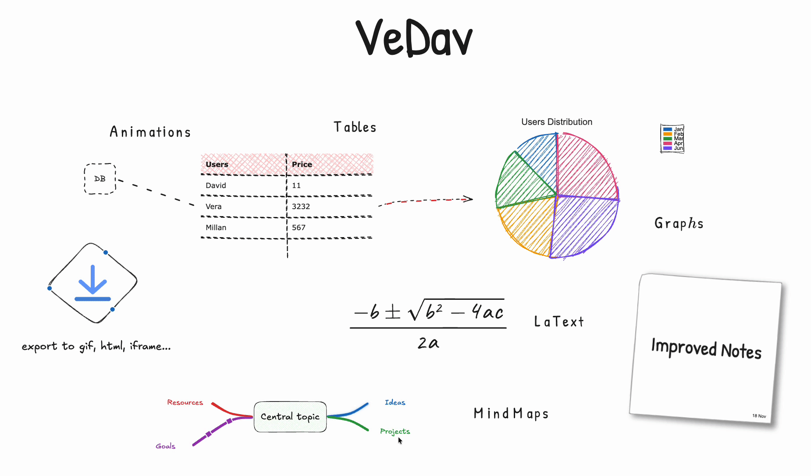

# VeDav

**Sketch ideas. Animate connections. Bring data onto the canvas.**



[Open VeDav](https://vedav.pages.dev/) · [Download desktop apps](https://github.com/davidgcorr/vedav/releases) · [GitHub Pages mirror](https://davidgcorr.github.io/vedav/) · [Report an issue](https://github.com/davidgcorr/vedav/issues)

VeDav brings freehand diagrams, animations, notes, math, charts, and editable tables into one sketch-style whiteboard. Use it in your browser or install the desktop app for macOS, Windows, or Linux.

VeDav is a fork of [Excalidraw](https://github.com/excalidraw/excalidraw). The editor is open source under the MIT license, with upstream promotions hidden by default and no separate VeDav Plus edition.


## What you can do

| Feature | On the canvas |
| --- | --- |
| **Draw and connect** | Sketch shapes, arrows, freehand strokes, and text. Customize colors, fills, line widths, arrowheads, and roughness. |
| **Animate** | Add moving dots, flowing dashes, or flowing arrows along connectors and shape outlines. Adjust speed, direction, color, marker amount, and size, or use shape effects such as bounce, shake, and spin. |
| **Add paper notes** | Drag white notes onto the canvas. Customize their border and text colors, stroke width, and shadow strength, distance, and diffusion. Double-click the bottom-right footer to edit or clear its text. |
| **Map ideas** | Build two-sided mind maps, add child and sibling topics, style branches, and arrange the tree. |
| **Write math** | Insert LaTeX or handwritten formulas with a live preview. Double-click a formula to edit its source. |
| **Work with data** | Import charts from CSV/JSON and tables from CSV, Excel, or JSON. Edit chart settings, table headers, and cells directly in the editor. |
| **Present** | Hide the controls and use the laser pointer. Press **Esc** or click the faint **×** in the top-right corner to exit. |
| **Export and embed** | Download PNG, SVG, animated GIF, or standalone HTML. Copy a self-contained iframe to embed animated diagrams in another page. |

Charts and tables share the editor's color palettes, fill patterns, stroke controls, and roughness presets. Caveat and Patrick Hand are also available in the text font selector.

## Get started

1. **Create:** choose a tool from the toolbar. Drag the note tool onto the canvas, or use the chart, table, formula, and mind-map tools to add richer content.
2. **Customize:** select an element to open its properties. Use **Animate** to configure motion; double-click formulas, charts, or table elements to reopen their editors.
3. **Save your drawing:** use **Save to disk** in the top-right corner, then reopen the `.excalidraw` file to continue editing its shapes, data, notes, and animations.
4. **Share:** use the adjacent **Export** button to choose an image, animation, or embeddable page. Use **Present** for a clean canvas with the laser pointer selected.

### Choose an export format

| Format | Best for |
| --- | --- |
| **`.excalidraw`** | Keeping the original drawing, data, and animation settings editable. |
| **PNG** | Sharing a raster image, with optional embedded scene data. |
| **SVG** | Sharing vector graphics, with optional embedded scene data. |
| **GIF** | Downloading a looping animation at the selected export scale. Choose a 1–10 second clip and **5, 10, or 20 fps**. |
| **HTML / iframe** | Sharing a standalone animated page or embedding it in another website. |

GIF exports have no app-imposed 2-million-pixel limit. Lower frame rates and shorter clips reduce file size and encoding work; browser memory and GIF format limits still apply. GIF files do not contain editable scene data, so save a separate `.excalidraw` copy when you need to keep editing.

## Install the desktop app

Choose an installer from [GitHub Releases](https://github.com/davidgcorr/vedav/releases):

| Platform | Download | Install |
| --- | --- | --- |
| **macOS** | `.dmg` | Open the disk image and drag the app into **Applications**. |
| **Windows** | `windows-x64-setup.exe` | Run the setup wizard. |
| **Linux** | `.AppImage` or `.deb` | Make the AppImage executable and launch it, or install the Debian package. |

Packaged apps include the editor and fonts; Node.js is not required. Drawing, local saving, and exports work offline. Online collaboration and fetching remote data require an internet connection.

Quit the running app before installing an update. Keep `.excalidraw` backups of important drawings, and check the installed version and build revision under **☰ → Preferences / Preferencias**.

See the [desktop guide](desktop/README.md) for platform-specific instructions, troubleshooting, signing, and update support.

## Guides

- [Charts and data import](desktop/ROUGHVIZ.md)
- [Editable tables](desktop/DATA-TABLES.md)
- [LaTeX and mind maps](desktop/KNOWLEDGE-TOOLS.md)
- [Animated HTML and iframe exports](desktop/HTML-EXPORT.md)
- [Desktop installation and builds](desktop/README.md)
- [Cloudflare deployment](desktop/CLOUDFLARE.md)
- [Reusable editor package](packages/excalidraw/README.md)

## Run from source

Use **Node.js 22.12 or newer**. From the repository root:

```sh
corepack yarn install --frozen-lockfile
corepack yarn start
```

Build the web app:

```sh
corepack yarn cloudflare:build
```

The production output is written to `excalidraw-app/build`.

Build a desktop installer for your current platform:

```sh
corepack yarn desktop:install
corepack yarn desktop:dist
```

Installers are written to `desktop/dist`. See the [desktop build guide](desktop/README.md) for cross-platform builds and release details.

## Deploy

The main site is hosted at [vedav.pages.dev](https://vedav.pages.dev/), with a [GitHub Pages mirror](https://davidgcorr.github.io/vedav/). Pushes to `master` run type checks and editor tests, build the app, and publish both sites through the [deployment workflow](.github/workflows/cloudflare-deploy.yml).

For credentials, first-time setup, custom domains, and manual publishing, follow the [Cloudflare deployment guide](desktop/CLOUDFLARE.md).

## Contribute and credits

Bug reports, feature requests, and contributions are welcome at [davidgcorr/vedav](https://github.com/davidgcorr/vedav). See [CONTRIBUTING.md](CONTRIBUTING.md) and the [feature milestones](desktop/MILESTONES.md).

VeDav builds on [Excalidraw](https://github.com/excalidraw/excalidraw), with charts powered by [roughViz](https://github.com/davidgcorr/roughViz). Licensed under [MIT](LICENSE); original copyright and dependency license notices are retained.
